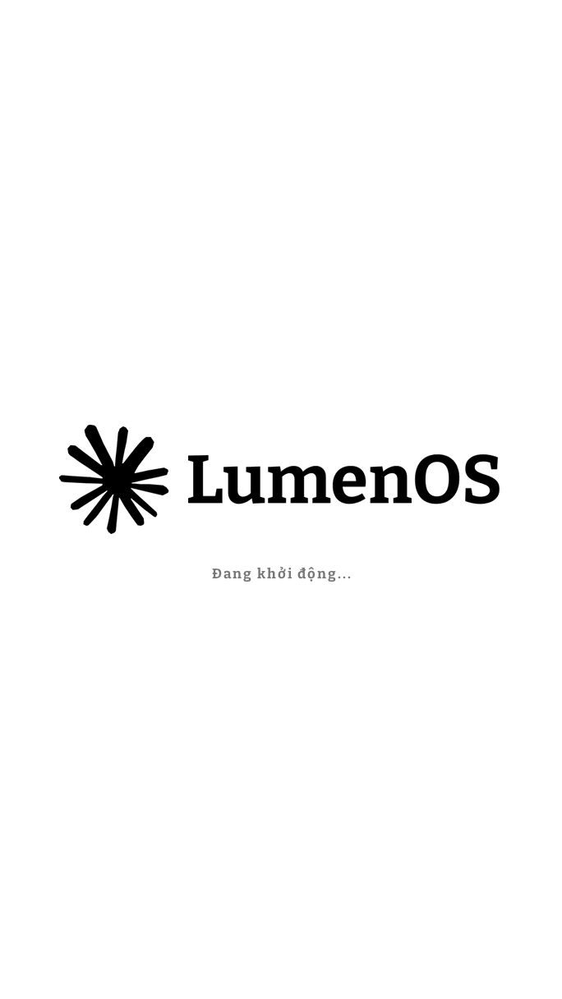
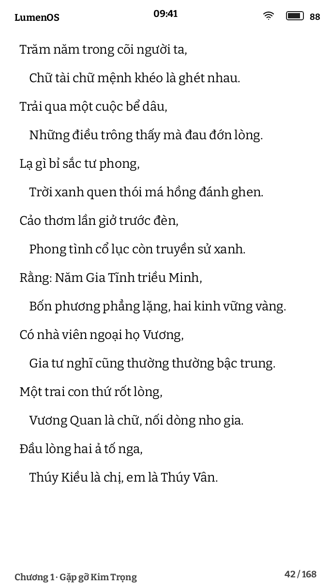
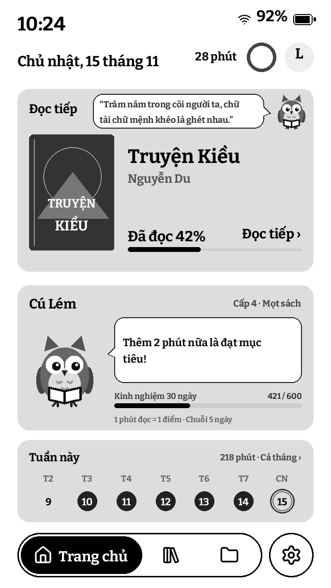
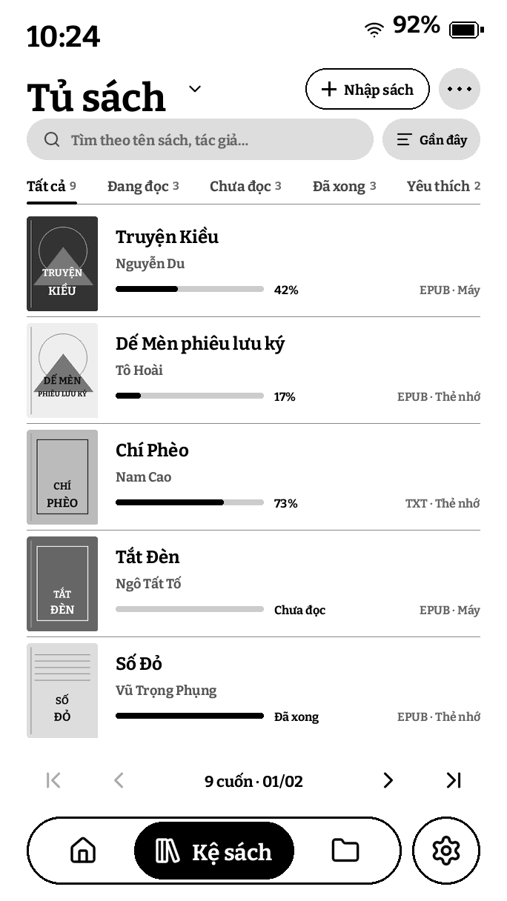
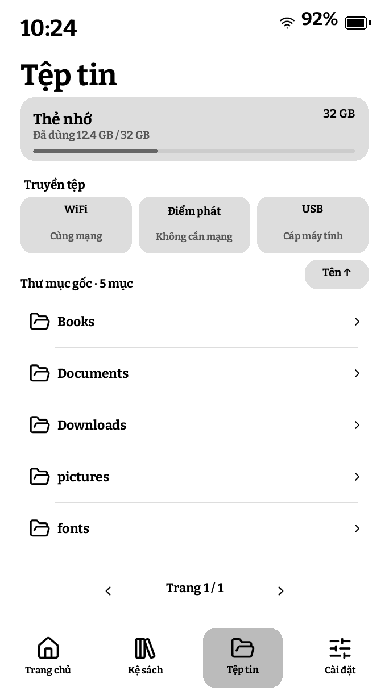
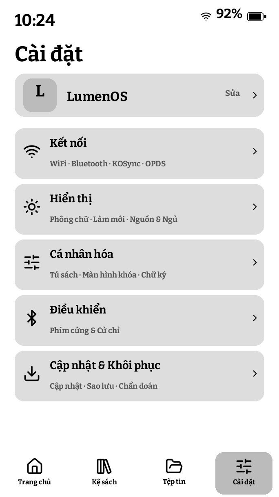

# LumenOS

<p align="center">
  
</p>

**Firmware đọc sách tiếng Việt cho Metalio E-ink 4 Plus 4.7 inch, ESP32-S31.**
LumenOS là nhánh cá nhân phát triển từ dpReader, dùng logo PNG trắng đen do người dùng cung cấp và tiếp tục duy trì mã nguồn cùng các giấy phép của dự án gốc.

Bản hiện tại: **Full `1.5.12`** và **Love Book `1.5.12-love`** — bản phát hành chính thức trên kênh `loozzi/lumenos` ([Releases](https://github.com/loozzi/lumenos/releases)); chưa nghiệm thu đầy đủ trên thiết bị.
Mỗi lần giao build mới tăng phiên bản riêng: `1.5.1`, `1.5.2`…; Love Book thêm hậu tố `-love`.

[Cài đặt và sử dụng](docs/CAI_DAT.md) · [Thay đổi theo phiên bản](docs/CHANGELOG.md) · [Hai bản firmware](docs/FIRMWARE_EDITIONS.md) · [Build cho S31](docs/BOARDS.md)

## Giao diện

Ảnh khởi động dưới đây được dựng bằng **mã C vẽ màn khởi động của firmware**, dùng đúng logo đóng gói trong bản 1.5.0. Các ảnh còn lại là **minh họa bố cục với dữ liệu sách mẫu**, dùng phông chữ và biểu tượng trong kho mã (chú cú trên Trang chủ được vẽ bằng chính mã C của firmware); không phải ảnh chụp thiết bị hay phép đo chất lượng màn E-ink.

| Khởi động LumenOS | Trình đọc TXT/EPUB |
| :---: | :---: |
|  |  |

| Trang chủ Full | Tủ sách Full |
| :---: | :---: |
|  |  |

| Tệp tin | Cài đặt |
| :---: | :---: |
|  |  |

Các ảnh dpReader cũ trong `docs/screenshots/` được giữ để tham khảo lịch sử. Xem [nguồn và cách tạo lại ảnh](docs/screenshots/lumenos/README.md).

## Full và Love Book

Hai bản dùng chung trình đọc, phông chữ, tiến độ đọc và phần điều khiển phần cứng. Đây là **hai cấu hình biên dịch**, khác với lựa chọn giao diện trong bản Full.

| | Full | Love Book |
| --- | --- | --- |
| Phiên bản hiện tại | `1.5.12` | `1.5.12-love` |
| Trang chủ | Chọn Đầy đủ hoặc I Love Book | Cố định I Love Book |
| Mở sách | Tủ sách, lịch sử và trình quản lý tệp | Trình chọn TXT/EPUB theo thư mục |
| Quản lý kệ sách, kiểu kệ, khóa ghép bìa | Có | Lược bỏ |
| Đọc sách, Wi-Fi, USB, OPDS, KOSync | Có | Có |
| PIN mở máy/đánh thức | Theo thiết lập | Không dùng PIN |

Trong Full, đổi giao diện tại **Cài đặt → Cá nhân hóa → Giao diện**. I Love Book hiển thị thẻ sách lớn; chạm để đọc tiếp, vuốt lên mở Pop menu và vuốt xuống mở Quick Settings. Thiết lập Full đã lưu được giữ khi chuyển sang Love Book để có thể dùng lại khi quay về Full.

Chi tiết: [Full và Love Book](docs/FIRMWARE_EDITIONS.md), [chức năng Love Book](docs/LOVE_BOOK_FEATURES.md).

## Tính năng

- **Đọc TXT/EPUB tiếng Việt:** dàn trang theo từ, mục lục, dấu trang, tìm kiếm, lưu tiến độ và tùy chỉnh phông, cỡ chữ, độ đậm, căn lề, giãn dòng.
- **Giao diện thẻ xám:** Trang chủ, Tủ sách, Tệp tin và Cài đặt dùng bố cục thống nhất; công cụ đọc và các trang thiết lập tiếp nối cùng kiểu hiển thị.
- **Thú cưng Cú Lém (Full):** chú cú trên Trang chủ đổi cảm xúc theo thói quen đọc (ngủ gật, nhớ bạn, ngóng, đang đọc, vui sướng, học giả), lên cấp theo số phút đọc 30 ngày gần nhất và trích câu trong chương đang đọc. Chạm vào thẻ để cú nói câu khác.
- **Tủ sách dạng danh sách:** ô tìm kiếm luôn hiện, tab trạng thái có số đếm, mỗi trang 5 cuốn với bìa, tác giả, tiến độ và nơi lưu.
- **Điều khiển khi đọc:** phím cảm ứng, nút âm lượng và thao tác vuốt; hỗ trợ điều khiển lật trang Bluetooth. Các phím có thể gán thao tác phù hợp.
- **Truyền sách:** dùng Wi-Fi cùng mạng, điểm phát riêng hoặc USB. Web Portal quản lý tệp, cấu hình OPDS/KOSync và tải log đã xuất.
- **OPDS và KOSync:** duyệt, tải sách từ kho OPDS; đồng bộ tiến độ với KOReader Sync. Máy chủ và tài khoản có thể thay đổi trong cài đặt.
- **Cá nhân hóa:** đèn trắng/ấm, lịch đèn, hình khóa, chữ ký cho Thẻ đọc sách và ảnh khóa; sao lưu/khôi phục cấu hình trên thẻ SD.

### Thay đổi trong 1.5.0

- Đổi tên hiển thị, logo khởi động và trang truyền tệp thành **LumenOS**; tên mặc định cũ được chuyển sang tên mới, giữ tên người dùng tự đặt.
- Chọn nút AI và/hoặc âm lượng để đánh thức từ Sleep. Màn khóa sau reboot có thể vào Light Sleep; chỉ đặt timer khi có thời hạn ngủ hoặc hẹn tắt nguồn.
- Yêu cầu hủy tải và dừng Wi-Fi/Bluetooth trước khi khóa; tài nguyên còn bận thì giữ trang hiện tại.
- Thẻ đọc sách Full dùng bố cục bìa lớn như Love Book, hỗ trợ chữ ký tùy chỉnh; thu gọn thanh Acrylic.
- Thêm chữ Hán thông dụng khi phông chính thiếu ký tự, tăng nhẹ nét khi bật Tương phản chữ ở chế độ đen trắng.
- Làm sạch màn hình khi từ trình đọc về Home, giảm làm mới trùng; sửa giới hạn bộ đệm xem trước log và thêm chẩn đoán heap.

Xem đầy đủ trong [CHANGELOG](docs/CHANGELOG.md).

## Cài LumenOS 1.5.0

Các gói đã giao nằm trên máy build, không được đưa vào Git:

| Bản | Thư mục | Gói USB |
| --- | --- | --- |
| Full | `Test Build/1.5.0/` | `LumenOS_metalio47_1.5.0_USB.zip` |
| Love Book | `Test Build/1.5.0-love/` | `LumenOS_metalio47_1.5.0-love_USB.zip` |

1. Giải nén gói đúng bản muốn dùng.
2. Kết nối Metalio qua USB-C; nếu cần, dùng **Cài đặt → Nạp ROM qua máy tính** để vào chế độ nạp.
3. Chạy **`FLASH_USB.command` trên macOS** hoặc **`FLASH_USB.bat` trên Windows**. Có thể truyền cổng nối tiếp khi chạy từ Terminal, ví dụ `./FLASH_USB.command --port /dev/cu.usbmodem…`.
4. Sau khi máy khởi động lại, kiểm tra phiên bản trong Cài đặt: `1.5.0` hoặc `1.5.0-love`.

Gói có `SHA256SUMS.txt`, metadata kiểm chứng và launcher kiểm tra Bin, chip, MAC và bảng phân vùng trước khi ghi. Trên bố cục **NVS256 đang dùng từ dpReader 1.4.2**, launcher chỉ ghi ứng dụng và lựa chọn khởi động OTA, giữ bootloader, NVS, sách và dữ liệu người dùng. Bố cục cũ hoặc trống bị từ chối; gói này không tự cài sạch hay chuyển phân vùng. Xem [hướng dẫn bố cục NVS256](docs/NVS256_MIGRATION.md) nếu máy chưa dùng bố cục tương thích.

Launcher cần Python có `esptool >= 5.6` và `pyserial`; macOS ưu tiên môi trường ESP-IDF tương thích đã có. Hướng dẫn thiết lập môi trường hiện ngay trong launcher nếu còn thiếu. Launcher không sao lưu toàn bộ flash. macOS tự đóng cửa sổ Terminal riêng sau khi nạp thành công, giữ thông báo khi lỗi.

Tên ứng dụng **`dpReader_metalio47_firmware.bin`** được giữ để tương thích công cụ cũ. Chip, project `Kiikoread_Metalio_S31`, namespace NVS, đường dẫn sách/backup và định danh KOSync không đổi khi chuyển thương hiệu. Đổi tên không yêu cầu cài lại toàn bộ hệ thống trên máy có cùng bố cục.

### Web Flash và cập nhật qua mạng

Từ **1.5.1**, LumenOS phát hành chính thức trên [GitHub Releases của `loozzi/lumenos`](https://github.com/loozzi/lumenos/releases) và [Web Flash LumenOS](https://loozzi.github.io/lumenos/). Firmware 1.5.1 kiểm tra OTA ở `raw.githubusercontent.com/loozzi/lumenos` (ưu tiên) và GitHub Pages của repo này (dự phòng); không nhận bản dpReader từ repo gốc.

Máy đang chạy dpReader (kênh `dephia31`) hoặc LumenOS 1.5.0 không thấy bản mới qua OTA: cài bản mới nhất qua USB một lần bằng gói `dpReader-metalio47-<phiên bản>-USB.zip` trên Releases hoặc Web Flash. Việc build cục bộ không tự đăng Release, cập nhật website hoặc triển khai OTA.

## Truyền tệp, OPDS và KOSync

Mở **Truyền file** trên thiết bị, rồi mở địa chỉ hiển thị trên màn hình bằng điện thoại hoặc máy tính. Khi dùng điểm phát, tên mặc định là **LumenOS**; khi cùng mạng Wi-Fi có thể dùng IP hiển thị hoặc `http://dpreader.local` nếu mạng hỗ trợ mDNS.

Web Portal cho phép tải sách lên, duyệt/tải tệp trên thẻ và chỉnh tài khoản máy chủ. KOSync mặc định dùng `https://sync.vreader.cloud`; OPDS dùng `https://sach.vreader.cloud:8443/opds`. Có thể thay bằng máy chủ riêng.

Để lấy log, chọn **Xuất log ra thẻ nhớ** trong Cài đặt, rồi dùng **Tải log hệ thống** trên Web Portal. Bản tải về là log đã xuất gần nhất, không phải luồng log trực tiếp.

Xem [hướng dẫn sử dụng](docs/CAI_DAT.md), [sao lưu và khôi phục](docs/BACKUP_AND_RESTORE.md), [vòng đời Wi-Fi/Bluetooth](docs/NETWORK_LIFECYCLE.md).

## Phần cứng và phân vùng

Mục tiêu của bản này là **Metalio E-ink 4 Plus V1.5**, màn **E0470A14-AF 34 pin**, độ phân giải dọc **684 × 1216**, SoC **ESP32-S31 RISC-V**, flash **16 MiB** và PSRAM. Cấu hình S31 dùng cảm ứng FT6336, nguồn màn TPS65185/TCA9555 và waveform GC48/GL48/DU20 gốc. Các tài liệu/mã Pico còn trong cây nguồn là phần lịch sử hoặc mã dùng chung; không dùng chân, nguồn hay phân vùng ESP32-S3 để nạp S31.

Bảng hiện tại lấy từ [`boards/metalio47/partitions.csv`](boards/metalio47/partitions.csv):

| Phân vùng | Địa chỉ | Kích thước |
| --- | --- | --- |
| `otadata` | `0xD000` | 8 KiB |
| `phy_init` | `0xF000` | 4 KiB |
| `ota_0` | `0x10000` | 5 MiB |
| `ota_1` | `0x510000` | 5 MiB |
| `storage` | `0xA10000` | `0x5A0000` byte |
| `nvs` | `0xFB0000` | 256 KiB |
| `coredump` | `0xFF0000` | 64 KiB |

Bootloader S31 ở `0x2000`, bảng phân vùng ở `0x8000`. Dùng launcher đã kiểm chứng thay cho lệnh nạp theo địa chỉ của phiên bản cũ. Chi tiết phần cứng và SDK xem [BOARDS](docs/BOARDS.md).

## Build từ mã nguồn

Cần **ESP-IDF 6.1 hỗ trợ `esp32s31`**, toolchain RISC-V và môi trường Python của SDK. Dùng cấu hình sản phẩm theo bo; `sdkconfig.ci` chỉ để kiểm tra biên dịch.

```bash
source ~/esp/v6.1/export.sh
python3 tools/build_firmware.py \
  --board metalio47 --edition all --local-build \
  --idf-metalio47 "$IDF_PATH" \
  --python "$(command -v python)" \
  --tools "$HOME/.espressif" \
  --output build/lumenos-1.5.0
```

Công cụ tách nguồn dựng, sdkconfig, build và đầu ra cho Full/Love Book; xuất gói vào `Test Build/<version>/`. `--local-build` không stage Web Flash. Trước lần giao tiếp theo, tăng phiên bản trong `boards/metalio47/board.json`, đồng bộ mô tả phiên bản và xác nhận version thực trong Bin. Không ghi đè gói đã giao bằng binary khác cùng số.

Mã duy trì nằm ở `firmware/shared/`, `firmware/full/`, `firmware/love_book/` và `boards/metalio47/`; không sửa cây sinh trong `build/`. Bắt đầu từ [ONBOARDING](docs/ONBOARDING.md), [cấu trúc firmware](firmware/README.md) và [AGENTS.md](AGENTS.md).

## Nguồn gốc và giấy phép

LumenOS kế thừa dpReader và Metalio-S31-kiikoread. Các thông báo tác giả, giấy phép từng tệp và quyền của thành phần bên thứ ba tiếp tục được giữ. Đọc [LICENSE](LICENSE) và [THIRD_PARTY_NOTICES.md](THIRD_PARTY_NOTICES.md) trước khi tái sử dụng hoặc phân phối. Nguồn và cách tạo logo xem tại [tài nguyên thương hiệu](main/assets/branding/README.md).
